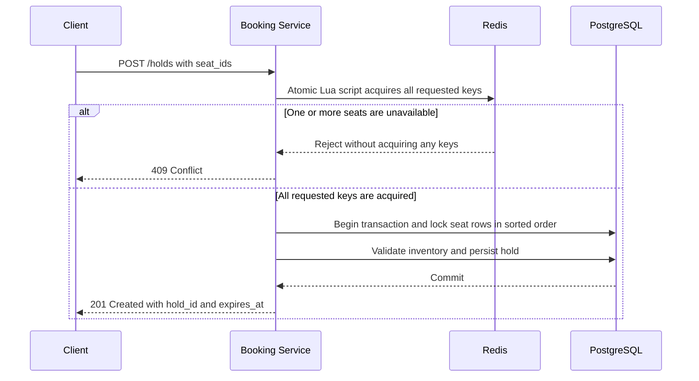
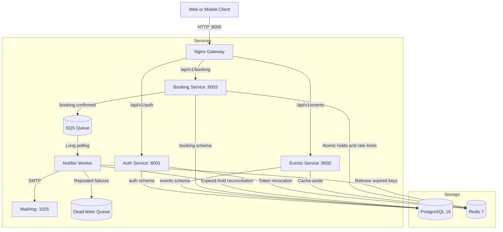

# SeatLock

A high-concurrency event ticket booking backend designed to prevent overselling during flash sales.

SeatLock models a common distributed-systems problem: many users competing for a limited inventory of seats at the same time. The system combines atomic Redis operations, PostgreSQL transactions, idempotent APIs, and asynchronous processing to keep booking state consistent under contention and recover from common failures.

[](https://www.python.org/)
[](https://fastapi.tiangolo.com/)
[](https://www.postgresql.org/)
[](https://redis.io/)
[](https://localstack.cloud/)
[](https://github.com/Git-Kapish/SeatLock/blob/main/LICENSE)
[](https://github.com/Git-Kapish/SeatLock/actions/workflows/ci.yml)

## Contents

- [Overview](#overview)
- [Core Design: Preventing Double Bookings](#core-design-preventing-double-bookings)
- [Architecture](#architecture)
- [Features](#features)
- [Technology Stack](#technology-stack)
- [Repository Structure](#repository-structure)
- [Getting Started](#getting-started)
- [API Overview](#api-overview)
- [Testing and Code Quality](#testing-and-code-quality)
- [Load Testing](#load-testing)
- [Kubernetes](#kubernetes)
- [Observability](#observability)
- [Documentation](#documentation)
- [Current Scope and Future Scaling](#current-scope-and-future-scaling)
- [Author](#author)

## Overview

Ticket sales for popular events create a concurrency problem: many customers may attempt to reserve the same seats within a short period. A straightforward implementation can oversell inventory, allocate only part of a multi-seat request, or encounter deadlocks when concurrent transactions lock the same rows in different orders.

SeatLock is designed to keep seat allocation correct while handling that contention. PostgreSQL is the source of truth for inventory and booking state. Redis provides a fast path for rejecting conflicting holds, while database transactions and relational constraints enforce correctness even when Redis is unavailable.

The project is organized as three FastAPI services—authentication, events, and booking—plus an asynchronous notification worker. It runs locally using Docker Compose and includes Kubernetes manifests for local cluster deployments.

### Project goals

- Prevent the same seat from being assigned to multiple active bookings.
- Make booking and webhook processing safe to retry.
- Release inventory when holds expire or payments fail.
- Keep service responsibilities and database schemas isolated.
- Support automated tests, load testing, structured logs, metrics, and containerized deployment.

## Core Design: Preventing Double Bookings

SeatLock uses three complementary safeguards. Redis improves contention handling, PostgreSQL coordinates concurrent transactions, and a database constraint protects the final invariant.



### 1. Atomic Redis holds

A Lua script attempts to acquire all requested seat keys as a single operation, using a ten-minute time-to-live. If any seat is already held, the operation fails without leaving a partial set of Redis locks.

### 2. PostgreSQL row-level locking

The booking service locks relevant seat rows with `SELECT ... FOR UPDATE`, ordered by `seat_id ASC`, inside a transaction. Consistent lock ordering reduces deadlock risk when requests overlap.

### 3. Database-level constraint

A partial unique index for active booking states—`pending_payment` and `confirmed`—provides a final safeguard against duplicate active allocations.

**Correctness invariant:** PostgreSQL remains authoritative. Redis is an optimization, not the source of truth; if Redis is empty or unavailable, the booking flow must still rely on database locking and constraints to preserve inventory correctness.

For a deeper explanation, see [Concurrency and Locking Model](docs/concurrency.md).

## Architecture



### Components

| Component | Port | Responsibility |
|---|---:|---|
| Nginx gateway | 8000 | Single entry point and request routing |
| Auth service | 8001 | Registration, login, JWTs, refresh-token rotation, roles, and token revocation |
| Events service | 8002 | Event lifecycle, catalog queries, filtering, pagination, and cache invalidation |
| Booking service | 8003 | Seat inventory, holds, bookings, mock payments, webhooks, and rate limiting |
| Notifier worker | — | SQS consumption, confirmation emails, retries, dead-letter handling, and expired-hold reconciliation |
| PostgreSQL | 5432 (internal) | Durable source of truth for users, events, seats, holds, bookings, and payments |
| Redis | 6379 (internal) | Cache, temporary hold keys, token revocation data, and distributed rate limiting |
| LocalStack SQS | — | Local development implementation of the queue integration |
| MailHog | 1025 SMTP | Captures locally generated confirmation emails |

### Design principles

- **Layered application design:** HTTP routes call services, and services call repositories. Business rules are kept out of route handlers.
- **Schema ownership:** the auth, events, and booking services use separate PostgreSQL schemas. Cross-service interactions use HTTP for validation or SQS for asynchronous side effects.
- **Explicit data conventions:** monetary amounts are represented as integer cents, timestamps use UTC, and identifiers use UUIDs.
- **Asynchronous I/O:** the services use FastAPI, SQLAlchemy's async interface with asyncpg, `redis.asyncio`, and `aioboto3`.

## Features

### Authentication and authorization

- Email and password registration with Argon2 password hashing.
- Short-lived JWT access tokens and rotating, revocable refresh tokens.
- Role-based access control for `user` and `admin` roles.
- Token revocation support.

### Events and inventory

- Administrative event creation, retrieval, updates, and deletion.
- Event status lifecycle: `draft`, `published`, `on_sale`, `sold_out`, `completed`, and `cancelled`.
- Event filtering by city, category, and date, with pagination and sorting.
- Seat inventory generation by section, row, and price tier.
- Redis cache-aside reads with cache invalidation.

### Booking and payments

- All-or-nothing multi-seat holds with a ten-minute expiration.
- Idempotent checkout using the `Idempotency-Key` request header.
- Mock payment provider for exercising payment outcomes.
- HMAC-SHA256-signed payment webhooks with provider-event deduplication.
- Booking history and cancellation with seat release.

### Reliability and traffic protection

- Redis token-bucket rate limiting for hold and booking endpoints.
- Standard `429` responses with `Retry-After` and `X-RateLimit-*` headers.
- A periodic hold sweeper to reconcile expired holds.
- SQS long polling, exponential backoff, jitter, and dead-letter routing after repeated failures.
- HTML booking confirmation emails, captured locally by MailHog.

## Technology Stack

| Area | Technology |
|---|---|
| Language | Python 3.12 |
| API framework | FastAPI, Pydantic v2 |
| Database and migrations | PostgreSQL 16, SQLAlchemy 2.0, asyncpg, Alembic |
| Cache and distributed coordination | Redis 7, `redis.asyncio`, Lua scripts |
| Messaging | AWS SQS, `aioboto3`, LocalStack for local development |
| Reverse proxy | Nginx |
| Containers and orchestration | Docker, Docker Compose, Kubernetes, Kustomize, kind |
| Observability | Prometheus, Grafana, structlog |
| Testing and quality | pytest, Ruff, mypy, k6 |
| Development tooling | `uv`, Make |

## Repository Structure

```text
seatlock/
├── services/
│   ├── auth/             # Authentication, users, tokens, and revocation
│   ├── events/           # Event catalog and caching
│   └── booking/          # Inventory, holds, bookings, and payments
├── workers/
│   └── notifier/         # SQS consumer, email delivery, and hold sweeper
├── libs/
│   └── common/           # Shared configuration, logging, errors, and integrations
├── gateway/              # Nginx configuration
├── deploy/
│   └── k8s/              # Kubernetes base manifests and overlays
├── observability/        # Prometheus and Grafana configuration
├── loadtest/             # k6 scenarios, seed data, and SQL invariant checks
├── docs/                 # Architecture, concurrency, runbook, and ADRs
├── docker-compose.yml
└── Makefile
```

Each service has an application package, Alembic migrations, and tests. Application code follows the `routes → services → repositories` dependency direction.

## Getting Started

### Prerequisites

- [Docker](https://docs.docker.com/get-docker/) with Docker Compose.
- [uv](https://docs.astral.sh/uv/) for Python tooling.
- [k6](https://k6.io/) if you plan to run load tests.

### 1. Clone and configure

```bash
git clone https://github.com/Git-Kapish/SeatLock.git
cd SeatLock
cp .env.example .env
```

Review `.env` and set the required local configuration values before starting the services.

### 2. Start the stack and apply migrations

```bash
make up
make migrate
```

The local stack includes the gateway, application services, notifier worker, PostgreSQL, Redis, LocalStack SQS, and MailHog.

### 3. Explore the API

The services expose interactive OpenAPI documentation at `/docs`. For example, the booking service documentation is available at:

```text
http://localhost:8003/docs
```

When running through the gateway, API routes are versioned under `/api/v1`. See [API Examples](docs/api-examples.md) and the [Postman collection](docs/postman/ticketrush.postman_collection.json) for request examples.

### Common commands

| Command | Purpose |
|---|---|
| `make up` | Start the local stack |
| `make down` | Stop the local stack |
| `make migrate` | Apply database migrations |
| `make test` | Run the test suite |
| `make test-svc S=booking` | Run tests for one service |
| `make lint` | Run Ruff lint and formatting checks |
| `make typecheck` | Run strict mypy checks |
| `make load-test` | Run the k6 flash-sale benchmark |
| `make k8s-local` | Create a kind cluster and apply the local overlay |

## API Overview

Endpoints are versioned under `/api/v1` and routed through the Nginx gateway. Errors use a consistent response structure:

```json
{
  "error": {
    "code": "SEAT_UNAVAILABLE",
    "message": "One or more seats are not available",
    "details": {}
  }
}
```

| Service | Method | Endpoint | Access |
|---|---|---|---|
| Auth | POST | `/auth/register`, `/auth/login`, `/auth/refresh`, `/auth/logout` | Public or authenticated, depending on endpoint |
| Auth | GET | `/auth/me` | Authenticated user |
| Events | GET | `/events`, `/events/{id}` | Public |
| Events | POST, PATCH, DELETE | `/events`, `/events/{id}` | Admin |
| Booking | POST | `/booking/events/{id}/inventory` | Admin |
| Booking | GET | `/booking/events/{id}/seats` | Public |
| Booking | POST, DELETE | `/booking/holds`, `/booking/holds/{id}` | Authenticated user; rate limited |
| Booking | POST | `/booking/bookings` | Authenticated user; requires `Idempotency-Key` |
| Booking | GET | `/booking/bookings`, `/booking/bookings/{id}` | Authenticated user |
| Booking | POST | `/booking/bookings/{id}/cancel` | Authenticated user |
| Booking | POST | `/booking/payments/webhook` | Signed webhook |

Each service also exposes `/health/live`, `/health/ready`, and `/metrics`. Rate-limited requests return HTTP `429` and include rate-limit headers.

## Testing and Code Quality

Run the test and quality checks with:

```bash
make test
make lint
make typecheck
```

The repository describes a suite of 101 automated tests covering unit, integration, and concurrency behavior. Scenarios include expired holds, duplicate requests, invalid tokens, payment failures, replayed webhooks, and Redis unavailability. Concurrency tests send simultaneous requests for the same seat and check that no more than one request can successfully allocate it.

Run these commands in your environment to confirm the current test results.

## Load Testing

The flash-sale scenario is designed to simulate 1,000 concurrent virtual users competing for 100 seats over 30 seconds.

```bash
# Seed 1,000 users, one event, and 100 seats
uv run python loadtest/seed.py

# Run the k6 flash-sale scenario
k6 run loadtest/k6/flash_sale.js

# Verify database invariants after the run
docker compose exec -T postgres psql -U ticketrush -d ticketrush < loadtest/verify_invariants.sql
```

### Expected invariants

| Check | Expected result |
|---|---|
| Confirmed bookings | Exactly 100 |
| Seats assigned to multiple active bookings | 0 |
| HTTP 5xx responses | 0 |

The SQL verification script checks database state directly rather than relying only on API responses. Treat the values above as acceptance criteria for the scenario; run the benchmark to establish results for your current environment.

## Kubernetes

Kubernetes manifests are under `deploy/k8s/` and use Kustomize bases and environment overlays. The described configuration includes Deployments, resource limits, liveness and readiness probes, ConfigMaps, Secrets, Ingress, and CPU-based autoscaling for the Events and Booking services. Database migrations are represented as a Job rather than being coupled to application startup.

For a local cluster:

```bash
make k8s-local
```

## Observability

- **Logging:** structured JSON logs via structlog, with a request ID propagated across services.
- **Metrics:** Prometheus-format metrics exposed at `/metrics`.
- **Dashboards:** Grafana dashboard configuration under `observability/grafana/`.
- **Health checks:** `/health/live` for liveness and `/health/ready` for readiness.

## Documentation

| Document | Description |
|---|---|
| [System Architecture](docs/architecture.md) | Service boundaries, communication flows, and security model |
| [Concurrency and Locking Model](docs/concurrency.md) | Redis Lua scripts, PostgreSQL row locking, and correctness invariants |
| [API Examples](docs/api-examples.md) | Example requests for API endpoints |
| [Operations Runbook](docs/runbook.md) | Local operations, troubleshooting, and diagnostics |
| [Postman Collection](docs/postman/ticketrush.postman_collection.json) | Importable API requests |

### Architecture Decision Records

- [ADR 0001: Monorepo Structure with a Common Library](docs/adr/0001-monorepo-structure.md)
- [ADR 0002: Atomic Seat Holds via Redis Lua](docs/adr/0002-redis-lua-seat-holds.md)
- [ADR 0003: Database Isolation via PostgreSQL Schemas](docs/adr/0003-postgres-schema-isolation.md)
- [ADR 0004: Idempotency for Bookings and Webhooks](docs/adr/0004-idempotent-booking-and-webhooks.md)

## Current Scope and Future Scaling

SeatLock is intended as a single-node deployment with separate application services. Potential next steps for higher traffic include partitioning inventory by event, introducing a dedicated inventory service, adding read replicas for catalog traffic, and implementing a queue-based waiting room for high-demand sales.

The payment provider is mocked, and LocalStack is used for local SQS development. These choices keep the project focused on backend reliability and concurrency rather than production payment processing.

## Author

Built by **Kapish**, final-year Electronics and Communication Engineering student at Delhi Technological University (Class of 2027). [GitHub profile](https://github.com/Git-Kapish).

## License

MIT. See [`LICENSE`](https://github.com/Git-Kapish/SeatLock/blob/main/LICENSE).
