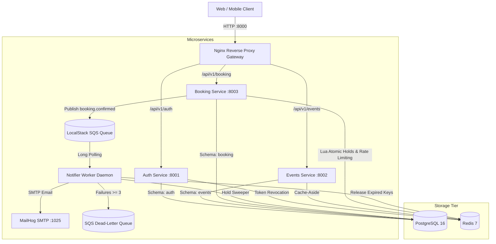

# TicketRush 🎟️

> High-concurrency event ticket booking backend platform engineered to eliminate overselling during flash sales.

[](https://www.python.org/)
[](https://fastapi.tiangolo.com/)
[](https://www.postgresql.org/)
[](https://redis.io/)
[](https://localstack.cloud/)
[]()
[]()

---

## ⚡ Problem Statement & Solution

During flash sales, thousands of users compete for a limited number of high-demand seats within seconds:
- **The Challenge**: Avoiding overselling, race conditions, partial allocations, and database deadlocks while maintaining low latency.
- **The TicketRush Solution**: A two-tier locking architecture:
  1. **Tier 1 (Atomic Redis Lua)**: An all-or-nothing Lua script evaluates and locks all requested seat keys simultaneously. If any seat is taken, the transaction aborts instantly without touching PostgreSQL.
  2. **Tier 2 (PostgreSQL Row-Level Locking)**: Executes `SELECT ... FOR UPDATE` ordered strictly by `seat_id ASC` (eliminating database deadlocks) and updates seat status within an ACID transaction.
  3. **Relational Constraints**: Relational partial unique index `WHERE status IN ('pending_payment', 'confirmed')` guarantees zero double-bookings at the storage engine level.

---

## 🏛️ System Architecture



---

## 🚀 Key Highlights

- **100% Microservice Schema Isolation**: Single PostgreSQL instance partitioned into schemas `auth`, `events`, and `booking`. Zero cross-schema foreign keys or joins.
- **Strict Layering**: `routes (HTTP) → services (business logic) → repositories (SQL queries)`.
- **Token Bucket Rate Limiting**: Distributed Redis token-bucket rate limiting on `/booking/holds` (10 req/min) and `/booking/bookings` (5 req/min) with `Retry-After`, `X-RateLimit-Limit`, and `X-RateLimit-Remaining` headers.
- **Idempotency & Webhook Deduplication**: `Idempotency-Key` header prevents duplicate checkouts on network retries; HMAC-SHA256 signature verification protects inbound payment webhooks.
- **Automated Hold Sweeper**: Periodic 30s background loop reconciles expired holds and restores seat inventory.
- **Asynchronous Event Worker**: Long-polling SQS consumer with exponential backoff, jitter, Dead-Letter Queue routing, and HTML receipt delivery.
- **Automated Invariant Verification**: SQL verification script mathematically verifying zero double-bookings after 1,000-user concurrent flash-sale load testing.

---

## 🛠️ Tech Stack

| Domain | Technology |
|---|---|
| **Language** | Python 3.12 (Strict type hints with `mypy`) |
| **Web Framework** | FastAPI (async) + Pydantic v2 |
| **Database** | PostgreSQL 16, SQLAlchemy 2.0 (asyncpg), Alembic |
| **Cache & Locks** | Redis 7 (`redis.asyncio`) with custom Lua scripts |
| **Messaging** | AWS / LocalStack SQS via `aioboto3` |
| **Reverse Proxy** | Nginx Gateway |
| **Orchestration** | Docker Compose, Kubernetes (Kustomize, `kind`) |
| **Observability** | Prometheus metrics (`/metrics`), Grafana dashboards, structlog JSON |
| **Load Testing** | k6 |

---

## 🏁 Quickstart

### Prerequisites
- Docker & Docker Compose
- `uv` (Fast Python package manager)

### 1. Launch Full Local Stack
```bash
# Starts Gateway, Auth, Events, Booking, Worker, Postgres, Redis, LocalStack SQS, MailHog
make up

# Run Alembic migrations across auth, events, and booking schemas
make migrate
```

### 2. Run Test Suite (101 Automated Tests)
```bash
make test
```

### 3. Verify Code Quality & Strict Typing
```bash
make lint       # Ruff linter & formatter check
make typecheck  # Strict mypy check across all packages
```

---

## 🧪 Concurrency & Load Testing

Simulates 1,000 concurrent virtual users competing for 100 seats over 30 seconds:

```bash
# Step 1: Seed 1,000 users, 1 event, and 100 seats
uv run python loadtest/seed.py

# Step 2: Run k6 flash-sale benchmark
k6 run loadtest/k6/flash_sale.js

# Step 3: Run post-run SQL invariant validation
docker compose exec -T postgres psql -U ticketrush -d ticketrush < loadtest/verify_invariants.sql
```

**Expected Result**:
- Confirmed Bookings: Exactly 100
- Duplicate Seats: Exactly 0
- 5xx Errors: Exactly 0

---

## 📚 Documentation & ADRs

- [System Architecture](file:///docs/architecture.md) — Comprehensive service design, communication flow, and security model.
- [Concurrency & Locking Model](file:///docs/concurrency.md) — Two-tier Redis Lua and PostgreSQL row locking breakdown.
- [API Examples & Curl Reference](file:///docs/api-examples.md) — Ready-to-run curl commands for every endpoint.
- [Operations & Runbook](file:///docs/runbook.md) — Local operations, troubleshooting, and diagnostics.
- [Postman Collection](file:///docs/postman/ticketrush.postman_collection.json) — Importable collection with pre-configured requests and environments.
- **Architecture Decision Records (ADRs)**:
  - [ADR 0001: Monorepo Structure with Common Library](file:///docs/adr/0001-monorepo-structure.md)
  - [ADR 0002: Atomic Seat Holds via Redis Lua](file:///docs/adr/0002-redis-lua-seat-holds.md)
  - [ADR 0003: Database Isolation via PostgreSQL Schemas](file:///docs/adr/0003-postgres-schema-isolation.md)
  - [ADR 0004: Idempotency Enforcement for Bookings & Webhooks](file:///docs/adr/0004-idempotent-booking-and-webhooks.md)
