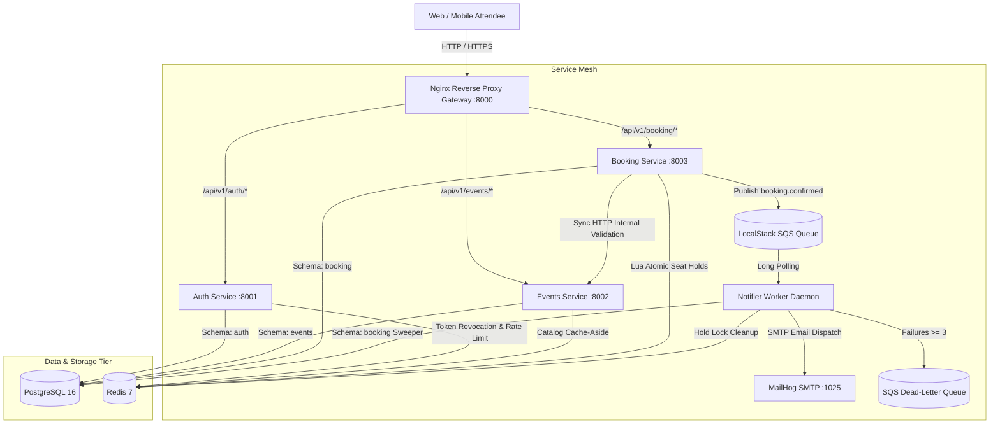

# TicketRush — System Architecture

TicketRush is a high-concurrency event ticket booking backend engineered to guarantee **zero overselling** during high-demand flash sales.

---

## 1. High-Level Architecture Diagram



---

## 2. Core Service Boundaries

| Service | Schema | Responsibilities | Key Technologies |
| :--- | :--- | :--- | :--- |
| **Auth Service** | `auth` | User registration, password hashing (Argon2id), JWT issue/refresh, token revocation | FastAPI, PyJWT, argon2-cffi, Redis |
| **Events Service** | `events` | Event catalog management, search, venue capacity, cache-aside read caching | FastAPI, Redis, SQLAlchemy |
| **Booking Service** | `booking` | Inventory seat grids, atomic Redis Lua seat holds, DB locking, checkout, payment webhooks | FastAPI, Redis Lua, PostgreSQL row locks, aioboto3 SQS |
| **Notifier Worker** | `booking` (read/sweep) | Async SQS message consumption, MailHog email delivery, exponential backoff, hold sweeper | Python asyncio, aioboto3, aiosmtplib |

---

## 3. Communication Patterns

### Synchronous Inter-Service Calls
- Used strictly for read-only validation where the calling service cannot proceed without authoritative data.
- **Example**: `BookingService` calls `GET /internal/v1/events/{id}` on `EventsService` to verify the event is `on_sale`.
- Protected by `X-Internal-Secret` header validation and resilient timeouts via `httpx.AsyncClient`.

### Asynchronous Event-Driven Messaging
- Used for side-effects, notifications, and cross-service eventual consistency.
- Standardized envelope format:
  ```json
  {
    "event_type": "booking.confirmed",
    "occurred_at": "2026-10-21T10:00:00Z",
    "payload": {
      "booking_id": "...",
      "user_id": "...",
      "event_id": "...",
      "total_cents": 15000,
      "seat_ids": ["..."]
    }
  }
  ```
- Guaranteed delivery via SQS retry backoff and Dead-Letter Queue routing.

---

## 4. Cross-Cutting Design Principles

1. **Strict Layering**: `routes (HTTP) → services (business logic) → repositories (SQL queries)`.
2. **Database Schema Isolation**: Each microservice owns its schema in PostgreSQL (`auth`, `events`, `booking`). No cross-schema foreign keys or joins.
3. **PostgreSQL Is Source of Truth**: Redis caches and locks are optimizations; correctness invariants are enforced by PostgreSQL ACID constraints.
4. **Idempotency Everywhere**:
   - `POST /booking/bookings` guarded by `Idempotency-Key` headers.
   - Payment webhooks deduped by `provider_event_id`.
   - SQS queue handlers safe to replay.
5. **Zero Blocking I/O**: Fully async pipeline across HTTP, DB (`asyncpg`), Cache (`redis.asyncio`), and Queue (`aioboto3`).
